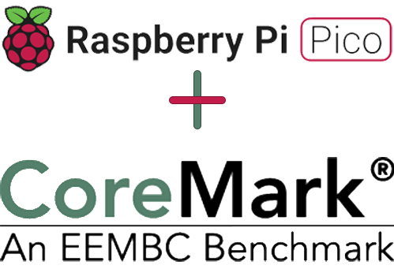

# CoreMark RP2040 & RP2350❤️

  [](https://github.com/username/repository/stargazers)
<!-- [](http://hits.dwyl.com/protik09/CoreMark-RP2040) -->



This is the [COREMARK®](https://github.com/eembc/coremark) embedded benchmark ported for the [RP2040 and RP2350](https://github.com/raspberrypi/pico-sdk)
chips from the folks over at Raspberry Pi. On the RP2350 it can run on either of the chip's core types: Arm Cortex-M33 or RISC-V Hazard3.

## Quick Start (No Build Required)

You don't need the SDK or a compiler to run the benchmark. All you need is to copy the right UF2 file onto your board:

| Board | Chip and cores | UF2 file |
| --- | --- | --- |
| Pico, Pico W | RP2040 (Arm Cortex-M0+) | [Coremark-RP2040.uf2](https://github.com/protik09/CoreMark-RP2040/releases/latest/download/Coremark-RP2040.uf2) |
| Pico 2, Pico 2 W | RP2350 (Arm Cortex-M33) | [Coremark-RP2350.uf2](https://github.com/protik09/CoreMark-RP2040/releases/latest/download/Coremark-RP2350.uf2) |
| Pico 2, Pico 2 W | RP2350 (RISC-V Hazard3) | [Coremark-RP2350-RISCV.uf2](https://github.com/protik09/CoreMark-RP2040/releases/latest/download/Coremark-RP2350-RISCV.uf2) |

1. Download the UF2 file for your board from the table above, or from the [latest release](https://github.com/protik09/CoreMark-RP2040/releases/latest).
2. Hold down the **BOOTSEL** button on the board while you plug it into your computer over USB, then let go. It shows up as a USB drive called **RPI-RP2** (Pico) or **RP2350** (Pico 2).
3. Drag the UF2 file onto that drive. The board restarts by itself and runs the benchmark firmware. On a Pico 2, the RP2350 starts the Arm or RISC-V cores to match the UF2 file.
4. Open a serial monitor on the board's USB serial port and press any key to start.

**IMPORTANT: Press any key to start the benchmark.**

You only need the build steps below if you want to change the code or build the firmware yourself.

## How to Build

You need the **Pico C/C++ SDK 2.0 or later** (earlier versions can't build for the RP2350), the Arm GCC toolchain, CMake and Ninja (or Make on Linux). The RISC-V build also needs Raspberry Pi's RISC-V GCC toolchain.

Each chip has its own build directory and its own UF2 file:

| UF2 file | Configure and build |
| --- | --- |
| Coremark-RP2040.uf2 | `cmake -S . -B build/rp2040 -DPICO_BOARD=pico` then `cmake --build build/rp2040` |
| Coremark-RP2350.uf2 | `cmake -S . -B build/rp2350 -DPICO_BOARD=pico2` then `cmake --build build/rp2350` |
| Coremark-RP2350-RISCV.uf2 | `cmake -S . -B build/rp2350-riscv -DPICO_BOARD=pico2 -DPICO_PLATFORM=rp2350-riscv` then `cmake --build build/rp2350-riscv` |

The Makefile runs these commands for you:

- `make all` builds **Coremark-RP2040.uf2** and **Coremark-RP2350.uf2** (needs only the Arm toolchain).
- `make riscv` builds **Coremark-RP2350-RISCV.uf2** (needs the RISC-V toolchain).
- `make clean` removes the build files.

The UF2, ELF and HEX files are copied to the **artifacts_to_upload** directory. `make` builds the Debug configuration by default. Add `BUILD_TYPE=Release` (for example `make all BUILD_TYPE=Release`) to build with the same settings as the release UF2 files. The plain `cmake` commands above build Release by default.

### For Microsoft Windows


The old pico-setup-windows installer stops at SDK 1.5.1, which can't build for the RP2350. Use the official [Raspberry Pi Pico extension for VS Code](https://marketplace.visualstudio.com/items?itemName=raspberry-pi.raspberry-pi-pico) instead:

1. Install the extension and create any new project with it once (for example the blink example), choosing Pico SDK 2.0 or later. This downloads the SDK, Arm GCC, CMake, Ninja and picotool into `%USERPROFILE%\.pico-sdk`. For the RISC-V build, also create a Pico 2 project for RISC-V once, so the extension downloads the RISC-V toolchain too.
2. In CMD, in this project's directory, run:

    ```cmd
    scripts\setup_env.bat
    ```

    It finds the newest SDK and tools in `%USERPROFILE%\.pico-sdk` and sets them up for that CMD window. If you still have the old installer and **PICO_INSTALL_PATH** set, it falls back to that, but then only the RP2040 build works.

3. Build with the `cmake` commands from the table above, or with `make all` / `make riscv` if you have GNU Make.

To clean the project directory:

```cmd
make clean || .\scripts\clean_win.bat
```

### For Linux


Set up the [Pico SDK](https://github.com/raspberrypi/pico-sdk) (2.0 or later) and set **PICO_SDK_PATH**. Then:

```bash
make all
```

For the RISC-V build, download `riscv-toolchain-*-x86_64-lin.tar.gz` from [pico-sdk-tools](https://github.com/raspberrypi/pico-sdk-tools/releases), extract it, add its `bin` directory to your `PATH`, and run:

```bash
make riscv
```

### Running it

Copy the UF2 file that matches your board (see the table in Quick Start) onto the board.

Open a Serial Monitor at 115200 baud (or just maximum USB speed)

**IMPORTANT**: Press any key to start the benchmark.

## Benchmarking steps

CoreMark runs three times in a row, and each run prints a complete, standard CoreMark report:

1. **Core 0 only**: one context on core 0.
2. **Core 1 only**: one context on core 1.
3. **Core 0 + Core 1**: two contexts, one per core, running at the same time.

A short summary at the end shows the chip and its system clock, then lists the Iterations/Sec and CoreMark/MHz of each run and the dual-core speed-up. Check each run's
report for `Correct operation validated`.

### Things you should know about the results of the benchmark

- Each chip runs at its fastest officially supported clock: 200 MHz for the RP2040 (the core voltage is raised to 1.15 V for this) and 150 MHz for the RP2350. The chips run at different speeds, so use CoreMark/MHz rather than Iterations/Sec to compare them. To build with the SDK's default clocks instead (125 MHz for the RP2040), add `-DPICO_USE_FASTEST_SUPPORTED_CLOCK=0` to the `cmake` configure command.
- Core 1 alone will most likely have a slightly higher score than core 0 by itself, because core 0 also handles the USB serial port.
- The both-cores result will likely be below 2x, because both cores fetch code from the same flash cache - which can become a bit of a bottleneck.

## RELEASES

[](https://github.com/protik09/CoreMark-RP2040/releases/latest)

## Reference Results

Results below are from my real official Raspi boards. Check that your board performs about the same given the constraints.

### Coremark-RP2350.uf2 (RP2350, Arm Cortex-M33 @ 150 MHz)

Measured 2026-11-21 on an official Raspberry Pi Pico 2. Release build, GCC 14.2.1 20241119, `-O3`.

| Run | Iterations/Sec | CoreMark/MHz | Iterations | Time (secs) |
| --- | --- | --- | --- | --- |
| Core 0 only | 425.729 | 2.838 | 6000 | 14.09 |
| Core 1 only | 425.748 | 2.838 | 6000 | 14.09 |
| Core 0 + Core 1 | 768.237 | 5.122 | 12000 | 15.62 |

Dual core speed-up vs Core 0 only: **1.80x**

### Coremark-RP2350-RISCV.uf2 (RP2350, RISC-V Hazard3 @ 150 MHz)

Measured 2026-11-21 on the same Raspberry Pi Pico 2. Release build, GCC 16.1.0, `-O3`.

| Run | Iterations/Sec | CoreMark/MHz | Iterations | Time (secs) |
| --- | --- | --- | --- | --- |
| Core 0 only | 494.565 | 3.297 | 6000 | 12.13 |
| Core 1 only | 494.565 | 3.297 | 6000 | 12.13 |
| Core 0 + Core 1 | 878.502 | 5.857 | 12000 | 13.66 |

Dual core speed-up vs Core 0 only: **1.78x**

### Coremark-RP2040.uf2 (RP2040, Arm Cortex-M0+ @ 200 MHz)

Measured 2026-11-21 on an official Raspberry Pi Pico. Release build, GCC 14.2.1 20241119, `-O3`.

| Run | Iterations/Sec | CoreMark/MHz | Iterations | Time (secs) |
| --- | --- | --- | --- | --- |
| Core 0 only | 395.131 | 1.976 | 6000 | 15.18 |
| Core 1 only | 395.131 | 1.976 | 6000 | 15.18 |
| Core 0 + Core 1 | 724.366 | 3.622 | 12000 | 16.57 |

Dual core speed-up vs Core 0 only: **1.83x**
